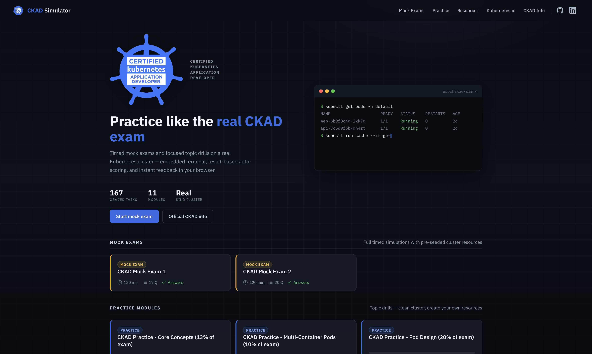

<div align="center">



# CKAD Simulator

**Practice the CKAD exam on a real Kubernetes cluster, in your browser.**

A local, open-source replica of the PSI exam environment — split-pane question panel,
live terminal, and a real [kind](https://kind.sigs.k8s.io/) cluster behind every `kubectl` you type.

[](LICENSE)
[](https://nodejs.org)
[](https://kubernetes.io)

[Quick start](#quick-start) · [How it works](#how-it-works) · [Contributing](.github/CONTRIBUTING.md) · [CKAD info](https://training.linuxfoundation.org/certification/certified-kubernetes-application-developer-ckad/)

</div>

---

## What is CKAD Simulator?

Most CKAD prep is reading. This is doing. You get the same interface you will see on
exam day, and every command runs against a genuine Kubernetes API server — not a
simulated shell. Break things, `kubectl describe` them, and get scored on the actual
cluster state you left behind.

- **Real cluster** — a kind cluster (Kubernetes v1.32) in Docker, with `kubectl`, `helm`, `vim`, `jq` and `yq`.
- **Exam-like UI** — questions on the left, terminal on the right, countdown timer, flagging, notepad.
- **2 mock exams** — 37 questions across isolated `exam-qN` namespaces, seeded from scenario manifests.
- **10 practice modules** — Core Concepts, Pod Design, Configuration, Observability, Services, State, Helm, CRDs, Podman, Multi-container Pods.
- **Automatic scoring** — review mode grades from live cluster state, your course files, and command history.
- **Fully local** — nothing leaves your machine, and your own clusters are untouched.

## Quick start

```bash
git clone https://github.com/yuciferr/ckad-simulator.git
cd ckad-simulator
./install.sh
```

That is the whole setup. `install.sh` installs Docker if it is missing, starts it if
it is not running, builds the images, creates the kind cluster, waits until it is
healthy, and opens <http://localhost:3000>. It is safe to re-run at any time.

The first run takes a few minutes while images are pulled and the cluster is created.

```bash
./install.sh --port 3001    # use a different host port
./install.sh --no-browser   # don't open the browser
./install.sh --yes          # never prompt (unattended)
```

### Requirements

| | |
|---|---|
| **Docker** | Engine 24+ / Desktop, with Compose v2 — installed for you if missing |
| **RAM** | 8 GB recommended (the cluster uses ~1 GB) |
| **OS** | macOS or Linux, on `arm64` or `amd64` |

### Everyday commands

```bash
make down          # stop everything
make logs          # follow backend logs
make cluster       # kubectl get nodes
make reset-q Q=3   # reset mock exam question 3 to a clean state
```

## How it works

```
Browser (xterm.js)  ──WebSocket──▶  Node.js backend (node-pty)
                                            │
                                    bash + kubectl + helm
                                            │
                                    kind cluster (Kubernetes v1.32)
```

Each question opens a PTY wired to a real shell inside the backend container. Before
you land on a question, its scenario manifest is applied to a dedicated namespace in
the background, so the terminal is usable immediately. Task files under `/opt/course/pN/`
are copied to a writable workspace per session, so you can edit them freely.

> The kind control-plane container appears **outside** the Compose group in Docker
> Desktop — kind creates it directly through the Docker socket. That is expected.

## Project structure

```
ckad-simulator/
├── install.sh            One-command setup
├── docker-compose.yml    kind-init + backend
├── docker/               Dockerfiles, kind config, shell config
├── src/
│   ├── sandbox/          Cluster access, scenarios, scoring evidence
│   ├── routes/  ws/      HTTP API and the WebSocket terminal
│   └── client/           Browser UI (TypeScript → public/js/)
├── exams/
│   ├── mock/{1,2}/       Questions, answers, scenarios, course files
│   └── practice/{slug}/  Practice modules
├── scripts/              Cluster init, question reset, content validators
└── tests/                Vitest unit tests
```

## Contributing

New questions, better scenarios, and bug fixes are all welcome — see
[CONTRIBUTING.md](.github/CONTRIBUTING.md) for the setup and the PR checklist.

## FAQ

<details>
<summary><b>Will this touch my existing Kubernetes clusters?</b></summary>

No. The simulator runs its own kind cluster with an isolated kubeconfig inside Docker.
Your `~/.kube/config` is never read or modified.
</details>

<details>
<summary><b>Can I run it without Docker?</b></summary>

Yes, with a local kind cluster, Node 18+ and `SANDBOX_MODE=kind`, but Docker Compose
is the supported path.
</details>

<details>
<summary><b>Something is stuck — how do I start over?</b></summary>

```bash
make down && docker rm -f ckad-simulator-control-plane && ./install.sh
```
</details>

## License

[MIT](LICENSE) — not affiliated with CNCF or the Linux Foundation.
