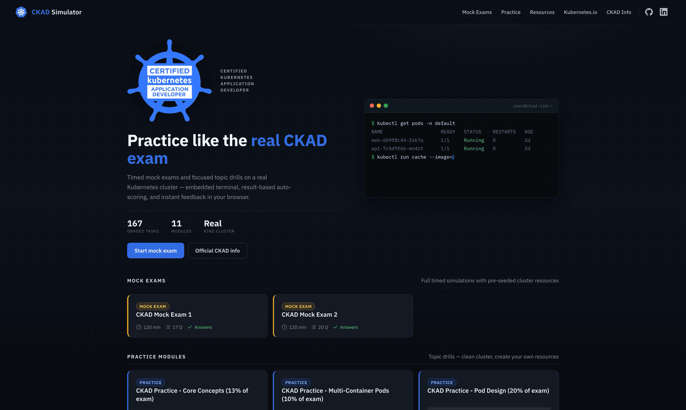
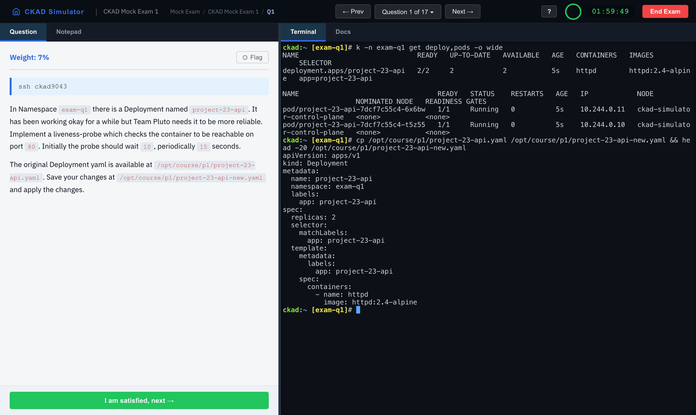
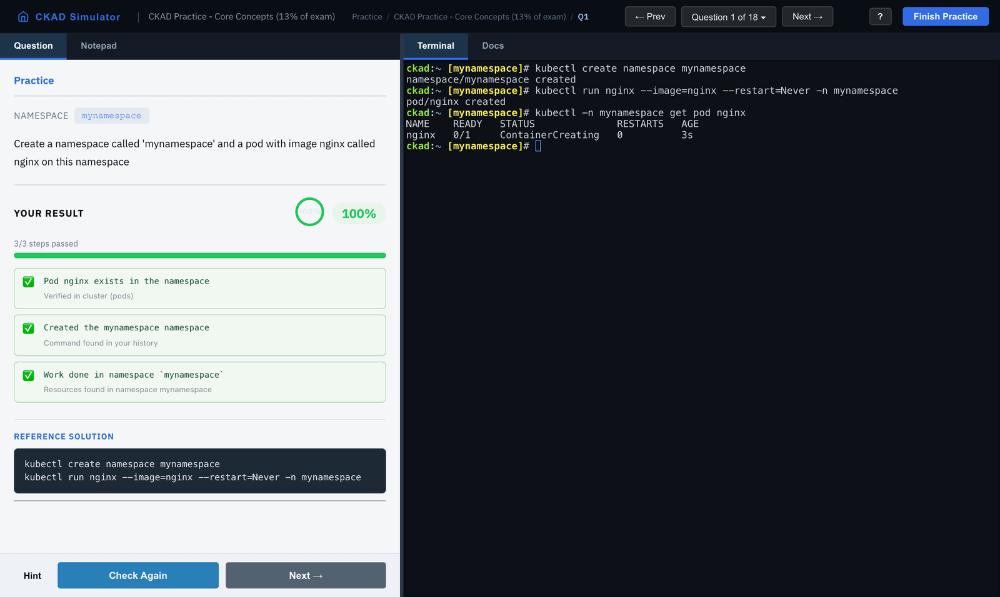
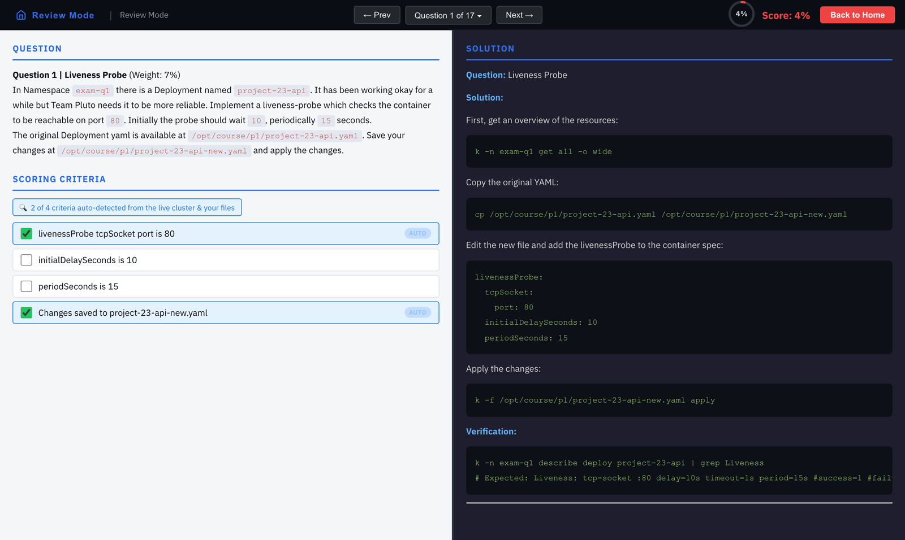

<div align="center">



# CKAD Simulator

**Practice the CKAD exam on a real Kubernetes cluster, in your browser.**

An open-source, self-hosted replica of the CKAD exam environment: questions on the left,
a live terminal on the right, and a real [kind](https://kind.sigs.k8s.io/) cluster behind
every `kubectl` you type — graded from the state you leave behind.

[](LICENSE)
[](https://kubernetes.io)
[](https://docs.docker.com/get-docker/)
[](.github/CONTRIBUTING.md)

[Website](https://ckad.celix.dev) · [Quick start](#quick-start) · [Step-by-step install](#step-by-step-installation) · [Troubleshooting](#troubleshooting) · [Contributing](.github/CONTRIBUTING.md)

</div>

---

## Contents

- [Why CKAD Simulator](#why-ckad-simulator)
- [Screenshots](#screenshots)
- [Quick start](#quick-start)
- [Step-by-step installation](#step-by-step-installation)
- [Using the simulator](#using-the-simulator)
- [Everyday commands](#everyday-commands)
- [Configuration](#configuration)
- [Updating and uninstalling](#updating-and-uninstalling)
- [Troubleshooting](#troubleshooting)
- [How it works](#how-it-works)
- [Project structure](#project-structure)
- [Development](#development)
- [Contributing](#contributing)
- [FAQ](#faq)
- [License](#license)

## Why CKAD Simulator

The CKAD is a two-hour, hands-on exam: you type into a terminal under a clock. Reading and
video courses don't build that muscle memory. This project gives you the real thing on
your own machine, as many times as you want.

| | |
|---|---|
| **Real cluster** | A kind cluster (Kubernetes v1.32) in Docker. `kubectl`, `helm`, `vim`, `jq`, `yq`, `kubectx` and `kubens` are pre-installed in the exam shell. |
| **Exam-like UI** | Split question panel, xterm.js terminal, countdown timer, flag for review, notepad and an in-app docs tab. |
| **203 graded tasks** | 2 timed mock exams (37 questions) and 10 practice modules (166 tasks). |
| **Automatic scoring** | Review mode grades every criterion from live cluster state, the files you saved and your command history. |
| **Isolated & resettable** | Each question gets its own namespace, pre-seeded before you reach it. Reset any question with one command. |
| **Fully local** | No account, no telemetry. Your `~/.kube/config` and existing clusters are never touched. |

## Screenshots

<table>
  <tr>
    <td width="50%"><br><sub><b>Exam</b> — task on the left, real cluster-backed terminal on the right.</sub></td>
    <td width="50%"><br><sub><b>Practice</b> — check your answer at any time and see which steps passed.</sub></td>
  </tr>
  <tr>
    <td width="50%"><br><sub><b>Review</b> — every criterion auto-graded next to the reference solution.</sub></td>
    <td width="50%"><br><sub><b>Dashboard</b> — pick a mock exam or a topic drill.</sub></td>
  </tr>
</table>

## Quick start

If Docker is already running on your machine:

```bash
git clone https://github.com/yuciferr/ckad-simulator.git
cd ckad-simulator
./install.sh
```

Your browser opens <http://localhost:3000> when the cluster is ready. That's it — the rest
of this README is detail.

## Step-by-step installation

### 0. Check the requirements

| Requirement | Details |
|---|---|
| **OS** | macOS or Linux, on `arm64` (Apple Silicon) or `amd64`. Windows: use WSL 2 with Docker Desktop's WSL integration. |
| **Docker** | Docker Engine 24+ or Docker Desktop, with Compose v2 (`docker compose version` must work). |
| **Memory** | 8 GB RAM recommended. The cluster itself uses about 1 GB; give Docker at least 4 GB. |
| **Disk** | About 2 GB for images on the first run. |
| **Tools** | `git`, and `curl` or `wget`. |

You do **not** need Node.js, `kubectl` or `kind` on your machine — they all run inside the containers.

### 1. Install Docker (skip if you already have it)

The installer in step 3 installs Docker for you if it is missing. If you prefer to do it yourself:

- **macOS:** install [Docker Desktop](https://docs.docker.com/desktop/setup/install/mac-install/) and start it once.
- **Linux:** install [Docker Engine](https://docs.docker.com/engine/install/) and the Compose plugin, then make sure your user can run `docker ps` without `sudo`.

Check it:

```bash
docker version
docker compose version
```

### 2. Clone the repository

```bash
git clone https://github.com/yuciferr/ckad-simulator.git
cd ckad-simulator
```

### 3. Run the installer

```bash
./install.sh
```

What it does, in order:

1. Checks for Docker and Compose v2 — installs Docker if missing, starts the daemon if it is not running.
2. Detects your CPU architecture (`arm64` / `amd64`).
3. Checks that the host port (default `3000`) is free.
4. Builds two images — `ckad-simulator-kind-init` (creates the cluster) and `ckad-simulator-backend` (web app + exam shell).
5. Creates a kind cluster named `ckad-simulator` and stores its kubeconfig on a private Docker volume.
6. Starts the backend and waits until `/health` reports the cluster as ready.
7. Opens <http://localhost:3000>.

The **first run takes a few minutes** while images are pulled and the cluster is created.
Later runs take seconds. The script is idempotent — re-running it is always safe.

### 4. Verify it is running

```bash
curl -s http://localhost:3000/health   # look for "cluster": { "ready": true, ... }
make cluster                           # kubectl get nodes, from inside the backend
```

> [!NOTE]
> In Docker Desktop the `ckad-simulator-control-plane` container appears **outside** the
> Compose group. That is expected — kind creates it directly through the Docker socket.

### 5. Take your first exam

Open <http://localhost:3000>, click **CKAD Mock Exam 1**, and type `k get ns` in the terminal.

## Using the simulator

**Mock exams** — two full exams (17 and 20 questions, 120 minutes, 66% to pass). Each question
has its own `exam-qN` namespace, pre-seeded with the resources the task mentions. Click
**End Exam** to enter review mode, where every criterion is scored automatically.

**Practice modules** — ten topic drills (Core Concepts, Pod Design, Configuration,
Observability, Services & Networking, State Persistence, Helm, CRDs, Podman, Multi-container
Pods) that start from a clean namespace. Use **Check Answer** at any time, open a hint, or
compare with the reference solution.

**In the terminal:**

- `k` is aliased to `kubectl`, with bash completion for both.
- Task files live in `/opt/course/pN/` — a writable copy per session, so edit freely.
- Press <kbd>?</kbd> in the exam view for keyboard shortcuts.

## Everyday commands

Run from the repository root. `make help` prints this list.

| Command | What it does |
|---|---|
| `make install` | Same as `./install.sh` |
| `make up` | Build and start the stack in the background |
| `make down` | Stop the stack (the kind cluster keeps its state) |
| `make logs` | Follow the backend logs |
| `make cluster` | Run `kubectl get nodes` inside the backend |
| `make reset-q Q=3` | Reset mock exam question 3 to a clean state |
| `make build` | Build the Docker images without starting them |

## Configuration

```bash
./install.sh --port 3001    # expose the app on another host port
./install.sh --no-browser   # don't open the browser when ready
./install.sh --yes          # never prompt (unattended / CI)
PORT=3001 ./install.sh      # same as --port
./install.sh --help         # all options
```

The host port is the only setting most people change. Cluster name, kubeconfig path and
sandbox mode are wired in [`docker-compose.yml`](docker-compose.yml).

## Updating and uninstalling

**Update:**

```bash
git pull
./install.sh        # rebuilds the images and restarts the stack
```

**Uninstall everything:**

```bash
docker compose down -v                                       # containers + kubeconfig volume
docker rm -f ckad-simulator-control-plane                    # the kind cluster
docker rmi ckad-simulator-backend ckad-simulator-kind-init   # the images
```

## Troubleshooting

<details>
<summary><b>Port 3000 is already in use</b></summary>

The installer detects this and stops before starting anything. Pick another port:

```bash
./install.sh --port 3001
```
</details>

<details>
<summary><b>The cluster never becomes ready</b></summary>

Follow the backend logs with `make logs`. On the first run, image pulls can take several
minutes on a slow connection. Make sure Docker has at least 4 GB of memory
(Docker Desktop → Settings → Resources).
</details>

<details>
<summary><b>Docker is not running</b></summary>

On macOS the installer launches Docker Desktop for you. On Linux, start the daemon and re-run:

```bash
sudo systemctl start docker
./install.sh
```
</details>

<details>
<summary><b>Something is stuck — start over from scratch</b></summary>

```bash
make down
docker rm -f ckad-simulator-control-plane
./install.sh
```
</details>

<details>
<summary><b>One question's cluster state is broken</b></summary>

Reset just that question's namespace and scenario:

```bash
make reset-q Q=5
```
</details>

## How it works

```
Browser (xterm.js)  ──WebSocket──▶  Node.js backend (node-pty)
                                            │
                                    bash + kubectl + helm
                                            │
                                    kind cluster (Kubernetes v1.32)
```

- **`kind-init`** is a one-shot container: it creates the cluster, writes the kubeconfig to a
  shared volume and exits. It is the only container with access to the Docker socket.
- **`backend`** serves the UI and opens a PTY per question. It talks to the cluster only
  through the Kubernetes API and runs with `no-new-privileges`.
- Before you reach a question, its scenario manifest is applied to that question's namespace
  in the background, so the terminal is usable immediately.
- Scoring is declarative: each answer lists `checks` against cluster resources, files and
  command history.

## Project structure

```
ckad-simulator/
├── install.sh              One-command setup (start here)
├── Makefile                Everyday commands — `make help`
├── docker-compose.yml      kind-init + backend services
├── docker/                 Dockerfiles, kind config, exam-shell bashrc/vimrc
├── server.js               Node entrypoint (loads the compiled dist/)
├── src/
│   ├── routes/  ws/        HTTP API and the WebSocket terminal
│   ├── sandbox/            Cluster access, scenarios, scoring evidence
│   ├── exam/               Exam registry and Markdown parsing
│   └── client/             Browser UI, TypeScript → public/js/ (own tsconfig.json)
├── public/                 index.html, CSS and images served to the browser
├── exams/
│   ├── manifest.json       Which exams exist, and in what order
│   ├── mock/{1,2}/         Questions, answers, scenarios, course files
│   └── practice/{slug}/    Practice modules
├── scripts/                Cluster init, question reset, content validators
├── tests/                  Vitest unit tests
├── sandbox/                Runtime workspace (generated, not source)
└── docs/                   Screenshots and development session logs
```

`dist/` and `public/js/` are build output and are git-ignored — edit `src/` instead.

## Development

To work on the server or UI, keep the Compose stack running for the cluster and iterate
with Node 18+:

```bash
npm install
npm run dev                  # build, then node --watch server.js
```

| Script | What it does |
|---|---|
| `npm run build` | Compile the server (`src/` → `dist/`) and the client (`src/client/` → `public/js/`) |
| `npm run dev` | Build, then run the server with `--watch` |
| `npm test` | Vitest unit tests (`tests/`) |
| `npm run lint` | Build the client, then run ESLint |
| `npm run format` | Prettier over `src/`, `scripts/` and `tests/` |
| `npm run validate:exams` | Validate every `exam.json` / `answer.json` |
| `npm run validate:scenarios` | Validate scenario namespaces |
| `npm run assign:practice-namespaces` | Re-allocate practice namespaces after editing practice questions |

## Contributing

New questions, better scenarios and bug fixes are all welcome. Read
[CONTRIBUTING.md](.github/CONTRIBUTING.md) for the content format and the PR checklist —
there is no CI, so please run `npm run build`, `npm test` and `make validate` before opening
a pull request.

## FAQ

<details>
<summary><b>Is it free?</b></summary>

Yes — MIT licensed, no paid tier, no account, no usage limits.
</details>

<details>
<summary><b>Will this touch my existing Kubernetes clusters?</b></summary>

No. The simulator runs its own kind cluster with an isolated kubeconfig inside Docker.
Your `~/.kube/config` is never read or modified.
</details>

<details>
<summary><b>Are these real exam questions?</b></summary>

No. They are original practice tasks written to match the style and scope of the CKAD
curriculum.
</details>

<details>
<summary><b>Can I run it without Docker?</b></summary>

Technically yes — a local kind cluster, Node 18+ and `SANDBOX_MODE=kind` — but Docker
Compose is the only supported path.
</details>

## License

[MIT](LICENSE). Not affiliated with the CNCF or the Linux Foundation. CKAD is a trademark of
the Linux Foundation.
