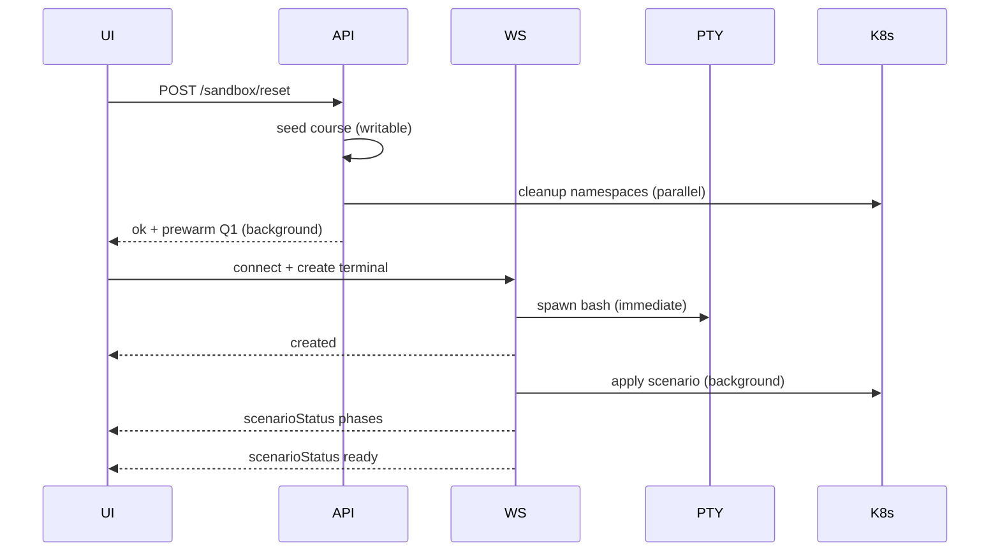

# 13 — Writable Course, Async Scenarios, Practice Kind Support

> **Branch:** `kind-migration`  
> **Session:** Exam UX fixes + practice module kind integration  
> **Status:** Course files writable; terminal non-blocking; practice scenarios started

---

## Problems Fixed

### 1. Read-only `/opt/course` (E212 in vim)

**Symptom:** `cp` / `vim` to `/opt/course/p1/project-23-api-new.yaml` failed with read-only file system.

**Cause:** Docker Compose mounted `./exams/mock/1/course:/opt/course:ro`.

**Fix:**
- Removed read-only course volume from `docker-compose.yml`
- On exam reset, `seedCourseFromExam()` copies seeds to writable `/app/sandbox/opt/course`
- PTY env sets `COURSE_DIR`; bashrc symlinks `/opt/course` → writable path when possible
- Evidence/scoring reads from `getCourseDir()` (writable copy)

### 2. Exam entry felt frozen

**Symptom:** Long wait with no feedback when opening mock exam / switching questions.

**Cause:** Terminal WebSocket `create` **awaited** full scenario reset (delete ns → apply → wait pods) before spawning PTY.

**Fix:**
- PTY opens **immediately**; scenario runs in background
- WebSocket sends `scenarioStatus` phases: `deleting` → `applying` → `waiting` → `ready`
- Terminal overlay shows progress (non-blocking)
- Exam start banner: “Preparing exam environment…” during sandbox reset
- Q1 scenario pre-warmed in background after reset

### 3. Practice modules not on kind path

**Cause:** `getScenarioPath` was mock-only; practice got empty `exam-qN` namespaces.

**Fix:**
- Practice uses **`default`** namespace (student creates resources as in CKAD exercises)
- Scenario support: `exams/practice/{module}/scenarios/qN/setup.yaml`
- Practice scenarios use `kubectl delete -f` / `apply -f` (multi-namespace OK)
- Initial practice scenarios:
  - `observability/q4` — failing liveness probes in qa/alan/test/production
  - `services/q9` — nginx Deployment + Service for NetworkPolicy lab

---

## Docker: Why `ckad-simulator-control-plane` Is Outside Compose Group

```
docker compose (ckad-simulator group)
├── ckad-kind-init     ← one-shot: creates kind cluster, exits
└── ckad-backend       ← Node app + PTY + kubectl

kind (separate — NOT a Compose service)
└── ckad-simulator-control-plane   ← Kubernetes API + node (kindest/node:v1.32.3)
```

**kind** creates its own containers via the host Docker socket. They appear **outside** the Compose project because kind manages them directly — this is expected and correct.

Flow:
1. `kind-init` calls `kind create cluster` → Docker runs `ckad-simulator-control-plane`
2. `backend` uses kubeconfig (patched with control-plane IP) to run kubectl
3. Student terminal = real kubectl against this cluster

---

## Architecture (Exam Flow)



---

## Files Changed

| Area | Files |
|------|-------|
| Writable course | `src/sandbox/course.ts`, `src/sandbox/reset.ts`, `docker-compose.yml`, `docker/bashrc` |
| Async scenarios | `src/ws/terminal.ts`, `src/sandbox/scenario.ts`, `src/client/terminal.ts` |
| Exam UX | `src/client/screens/exam-screen.ts`, `public/index.html`, `public/style.css` |
| Practice | `exams/practice/README.md`, `observability/scenarios/q4/`, `services/scenarios/q9/` |
| Evidence | `src/sandbox/evidence.ts` |
| Validation | `scripts/validate-scenarios.js` |

---

## Startup Contract (unchanged)

```bash
make up
curl http://localhost:3000/health   # cluster.ready: true
# Mock exam: vim /opt/course/p1/project-23-api-new.yaml — must save
# Terminal opens without long freeze; overlay shows scenario progress
```

---

## Still Pending

- [ ] Mock auto-score via `verify.sh` + `clusterState`
- [ ] More practice scenarios (configuration, pod_design chains)
- [ ] Ingress controller for mock Q11 / practice ingress labs
- [ ] Full README rewrite
- [ ] CI smoke test script

---

## Run

```bash
make up
open http://localhost:3000
npm run validate:scenarios   # 19 scenarios OK
```

After code changes: `docker compose up --build -d` (or `make up`).
